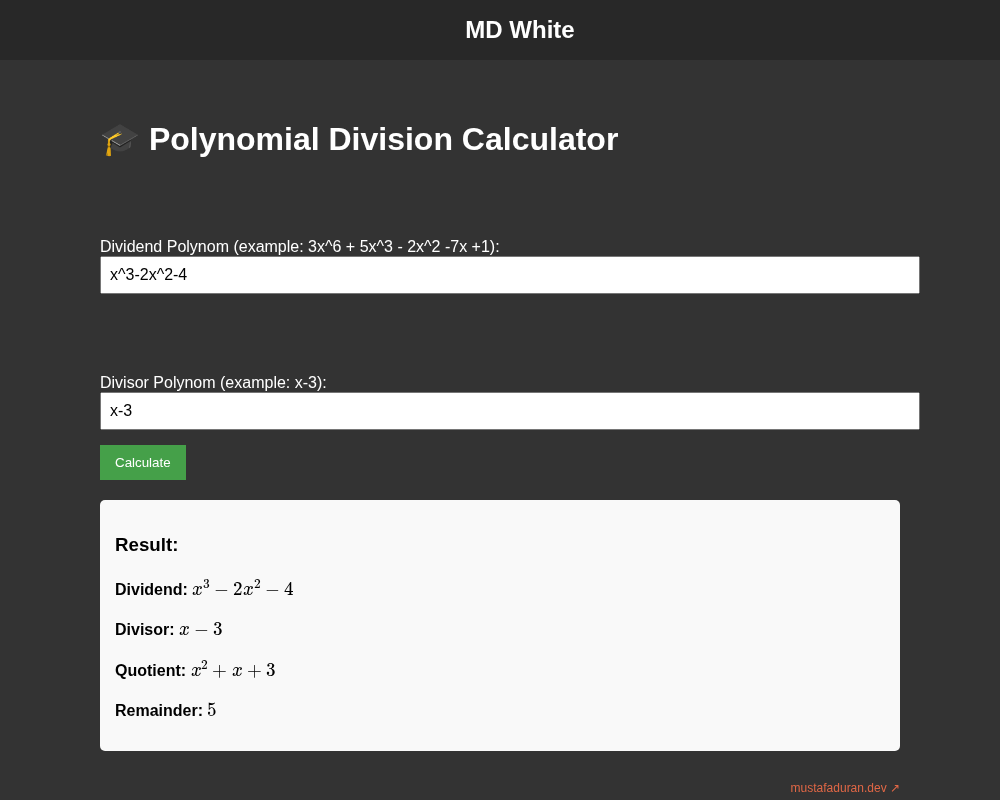

# Polynomial Division Calculator

A small single-page web app that divides one polynomial in `x` by another and
shows the quotient and remainder, rendered as math with MathJax.



## Features

- Type the dividend and divisor as plain text, e.g. `3x^6 + 5x^3 - 2x^2 -7x +1`
  and `x-3`. Spaces are ignored and letters are lower-cased.
- Terms can be written in any order; missing powers are treated as zero and
  repeated powers are added together (`2x + 3x` becomes `5x`).
- Coefficients may be integers or decimals; `x`, `-x` and `x^n` without a
  number mean a coefficient of 1 or -1.
- The result box shows the dividend, divisor, quotient and remainder, typeset
  with MathJax.

### How it works

All logic is in the inline `<script>` in `index.html`.

1. **Parsing** (`parsePolynomial`): every `-` is replaced with `+-`, the string
   is split on `+`, and each term is split on `x` into a coefficient and an
   exponent (`^n`, an implicit `1` for a bare `x`, or `0` for a constant). The
   polynomial is stored as an object that maps exponent to coefficient.
2. **Division** (`polynomialDivision`): ordinary polynomial long division.
   While the degree of the remainder is at least the degree of the divisor,
   the leading term of the remainder is divided by the leading term of the
   divisor, that term is added to the quotient, and the term times the divisor
   is subtracted from the remainder. Coefficients smaller than `1e-10` in
   absolute value are dropped to absorb floating-point error.
3. **Output** (`polynomialToString`): terms are sorted by descending exponent
   and written as TeX (`x^2 + x + 3`), then `MathJax.typeset()` renders them.

Example: `x^3-2x^2-4` divided by `x-3` gives quotient `x^2 + x + 3` and
remainder `5`.

### Known limitations

- Only the variable `x` is supported; parentheses, implicit multiplication
  such as `2(x+1)`, and negative exponents are not parsed.
- Dividing by a constant (a divisor with no `x`, e.g. `2`) never leaves the
  division loop and freezes the page.
- Coefficients are floating-point numbers, so non-integer results are shown
  as decimals rather than fractions.

## How to run

No build step and no dependencies to install. Open `index.html` in a browser,
or serve the folder locally:

```sh
python3 -m http.server 8000
# then open http://localhost:8000/
```

MathJax is loaded from the local `tex-mml-chtml.js`, so it also works offline.

## Project structure

```
index.html            the calculator: markup, styles and all of its JavaScript
tex-mml-chtml.js      MathJax 3 combined component (third-party)
output/chtml/fonts/   MathJax CHTML web fonts used for the output (third-party)
polyfill.min.js       JavaScript polyfill bundle (third-party, not referenced by index.html)
assets/script.js      GBA emulator loader, not used by index.html (see below)
assets/style.css      styles for that emulator page, not used by index.html
docs/screenshot.png   screenshot used in this README
```

### `assets/script.js` (emulator loader)

`assets/script.js` and `assets/style.css` are leftovers of a separate
experiment and are not loaded by `index.html`, so they do not affect the
calculator. The script expects a page with a `#startButton` and an
`#emulator` iframe; on click it fetches a Game Boy Advance ROM from
`assets/oyun.gba` and points the iframe at an emulatorjs.com GBA page. No ROM
is included in this repository (`*.gba` is in `.gitignore`); anyone who wants
to try that script has to supply their own ROM file at `assets/oyun.gba`. If
the file is missing, the script logs the error and shows an alert.

## Tech

- HTML, CSS and plain JavaScript (no framework, no build tools)
- [MathJax 3](https://www.mathjax.org/) for rendering the math

## Third-party code

- **MathJax** (`tex-mml-chtml.js`, `output/chtml/fonts/woff-v2/*.woff`),
  Copyright (c) The MathJax Consortium, licensed under the
  [Apache License 2.0](https://www.apache.org/licenses/LICENSE-2.0).
  Only the two fonts the calculator output needs are bundled.
- **polyfill.min.js**: a minified browser polyfill bundle built on
  [core-js](https://github.com/zloirock/core-js) (MIT License). It is not
  loaded by the page.

These files keep their own licenses; the MIT license in `LICENSE` covers only
the original code of this project.

## Background

Built in September 2023 as a high-school project and published on
[mustafaduran.dev](https://mustafaduran.dev/projects/project4/).

## License

MIT © 2023 Mustafa Duran. See [LICENSE](LICENSE).
